# Optivra Pro — Sistema de Gestão em Optometria

### Uma solução digital desenvolvida com apoio de Inteligência Artificial

## 1. Sobre o projeto

O Optivra Pro é uma aplicação desktop desenvolvida em Python, voltada à gestão de operações em optometria.

O projeto surgiu da identificação de um problema operacional: informações de pacientes, consultas, prescrições e acompanhamentos estavam distribuídas entre planilhas e documentos independentes.

Essa fragmentação dificultava a localização de históricos, o acompanhamento de retornos e a organização das atividades do dia a dia.

A proposta foi transformar esse cenário em uma solução digital integrada, centralizando informações e estruturando os principais processos em um único ambiente.

## 2. Objetivo da solução

Desenvolver um sistema de gestão capaz de organizar informações, integrar rotinas operacionais e facilitar o acesso aos registros, contribuindo para maior controle e eficiência nos processos.

## 3. Principais funcionalidades

- Cadastro e pesquisa de pacientes.
- Registro e gestão de consultas.
- Histórico e prontuário.
- Emissão de receitas e documentos.
- Acompanhamento pós-consulta.
- Controle de retornos anuais.
- Gestão de aniversariantes.
- Geração de relatórios em PDF e Excel.

## 4. Tecnologias utilizadas

- Python
- Tkinter / ttk
- SQLite
- ReportLab
- OpenPyXL
- Requests

## 5. Metodologia de desenvolvimento — AI-Assisted Development

O Optivra Pro foi construído utilizando uma abordagem de desenvolvimento assistido por Inteligência Artificial (*AI-Assisted Development*).

As ferramentas de IA foram utilizadas como apoio técnico durante diferentes etapas da construção e evolução do sistema, incluindo implementação de funcionalidades, análise de código, revisão e resolução de problemas.

O processo envolveu:

- Idealização da solução e identificação do problema.
- Levantamento e estruturação de requisitos.
- Planejamento dos módulos e fluxos operacionais.
- Organização e migração de dados.
- Construção assistida por IA, com implementação em Python.
- Testes funcionais, validação e melhorias iterativas.

As decisões sobre necessidades, prioridades e funcionalidades, assim como a validação da solução, foram conduzidas durante o processo de construção do produto.

**Classificação:** Desenvolvimento assistido por IA. Não se trata de uma solução exclusivamente No-Code.

## 6. Minha participação

**Antonio Junior — Idealização, construção e validação**

Minha atuação envolveu a identificação da necessidade operacional, concepção da solução, definição de funcionalidades, organização de informações, estruturação dos requisitos, orientação do desenvolvimento assistido por IA e validação dos recursos implementados.

O projeto representa a aplicação prática da experiência em processos e negócios na construção de uma solução tecnológica.

---

# 7. Demonstração visual do sistema

As imagens a seguir apresentam os principais módulos e recursos do Optivra Pro.

## 7.1 Interface e gestão

### Tela inicial
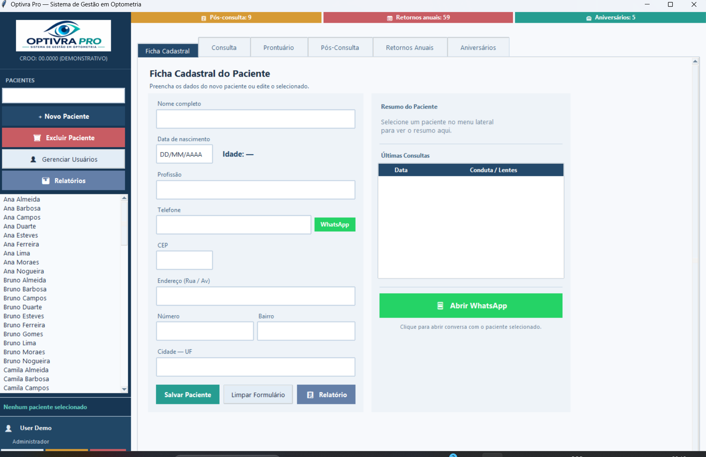

### Cadastro de pacientes
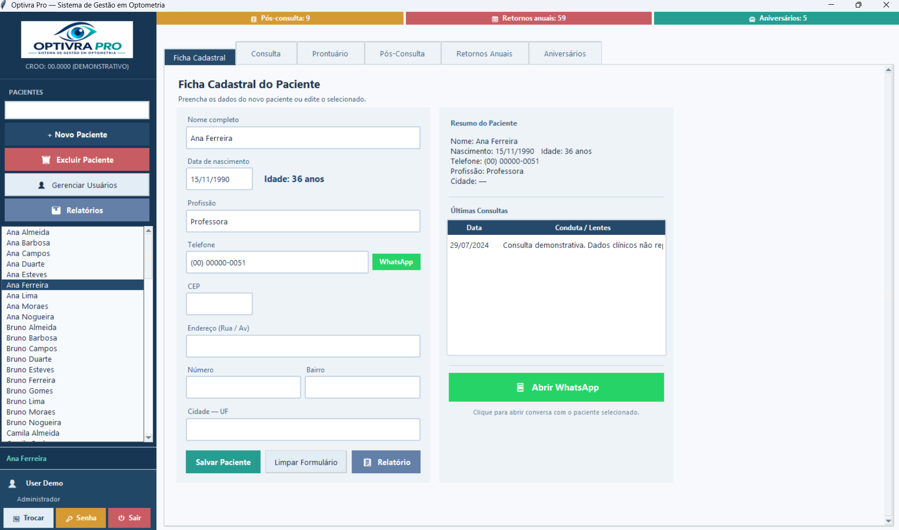

### Painel de consultas
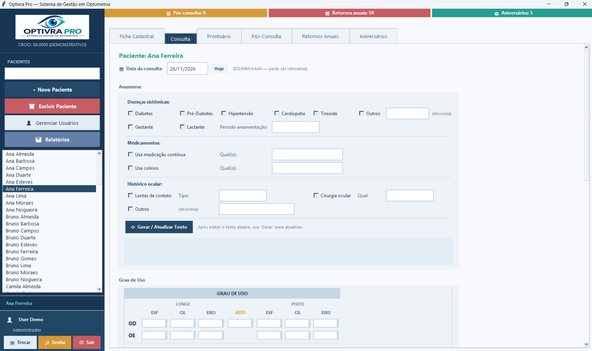

## 7.2 Consultas e prontuário

### Ficha de consulta
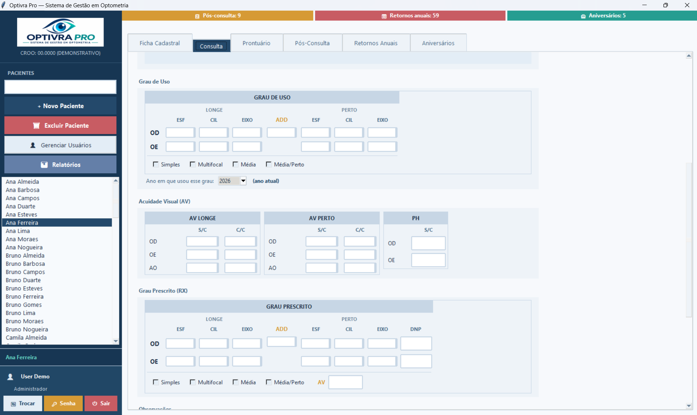

### Ficha de consulta — continuação
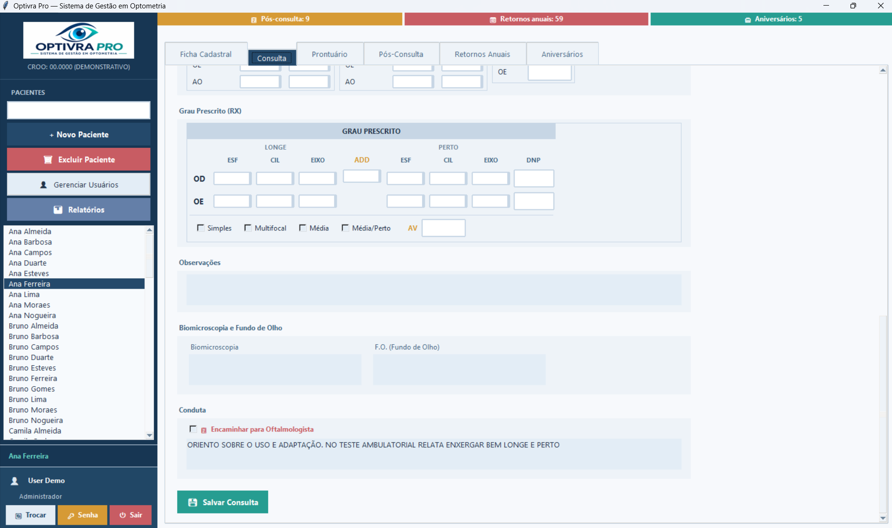

### Prontuário
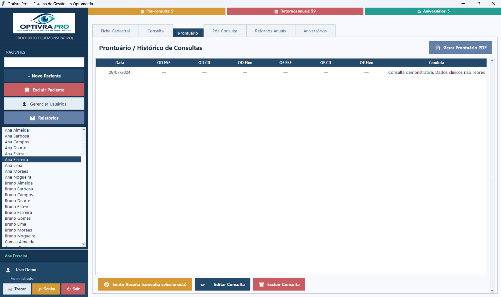

## 7.3 Acompanhamento

### Pós-consulta
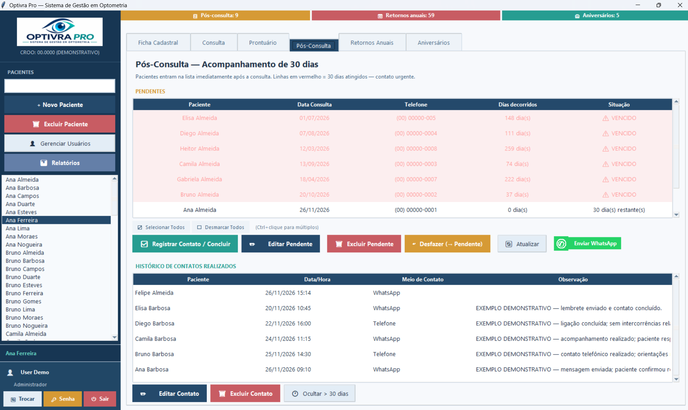

### Retornos anuais
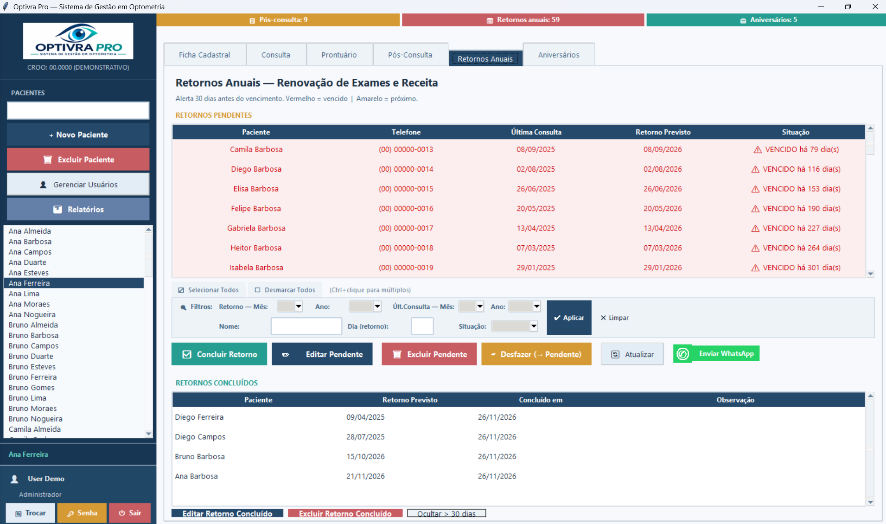

### Aniversariantes
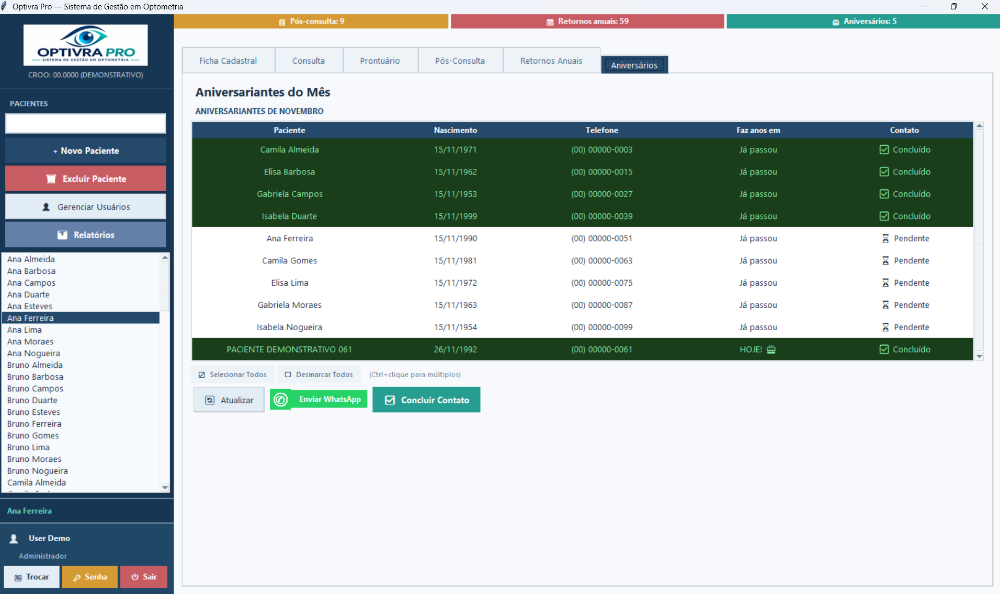

### Central de relatórios
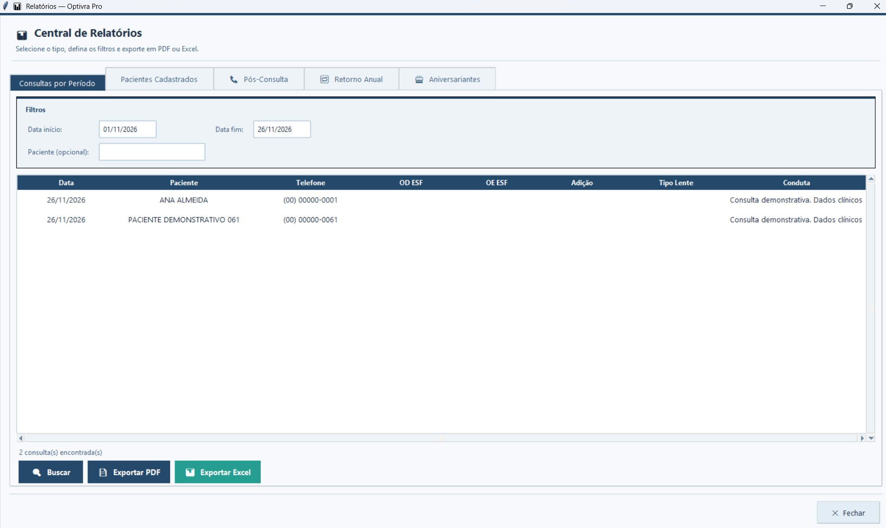

---

# 8. Documentos e relatórios gerados

O sistema também oferece recursos para geração de documentos e exportação de informações.

### Receita óptica
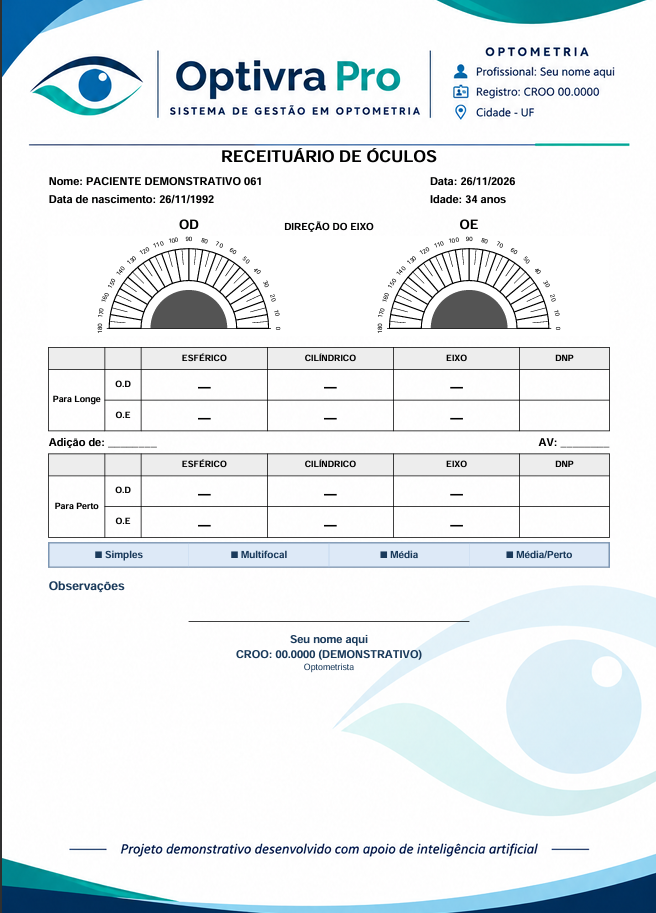

### Relatório demonstrativo
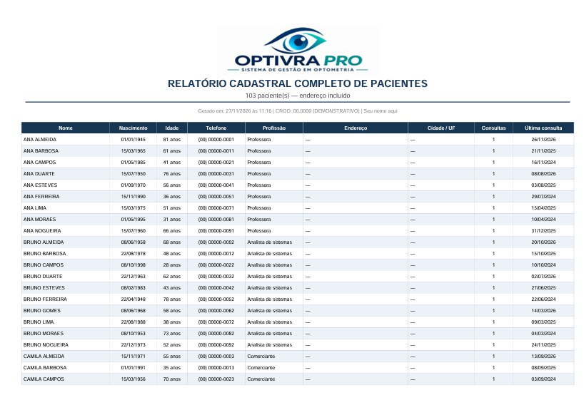

### Relatório de aniversariantes
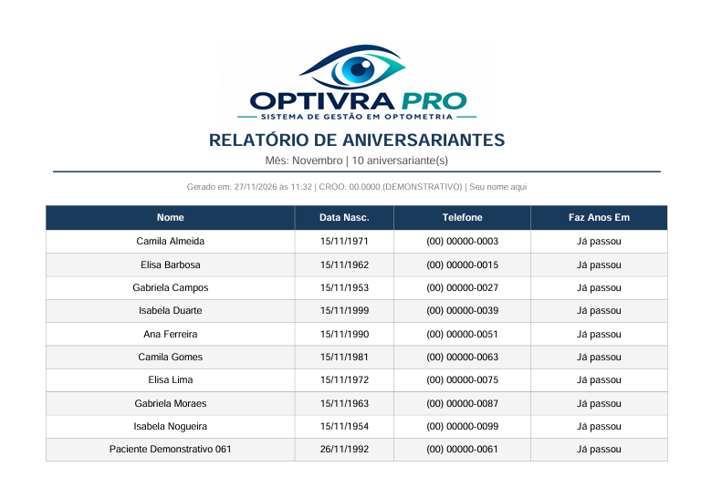

### Relatório de pós-consulta
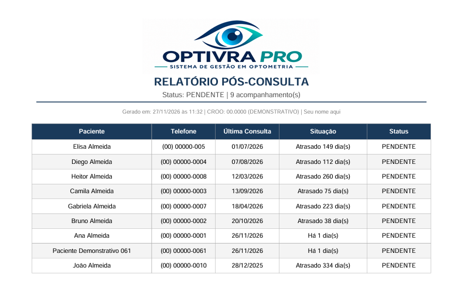

### Exportação para Excel
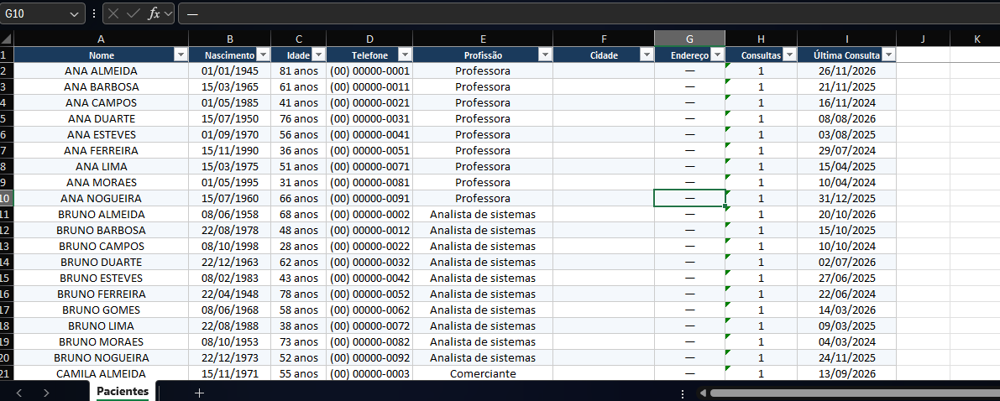

---

## 9. Proteção e disponibilidade

Este repositório apresenta o projeto para fins de portfólio profissional.

O código-fonte e o banco de dados original permanecem privados. As imagens públicas utilizam materiais demonstrativos e dados fictícios.

---

**Optivra Pro — Sistema de Gestão em Optometria**

**Antonio Junior**  
AI Builder | Soluções Digitais | Tecnologia aplicada a Negócios
