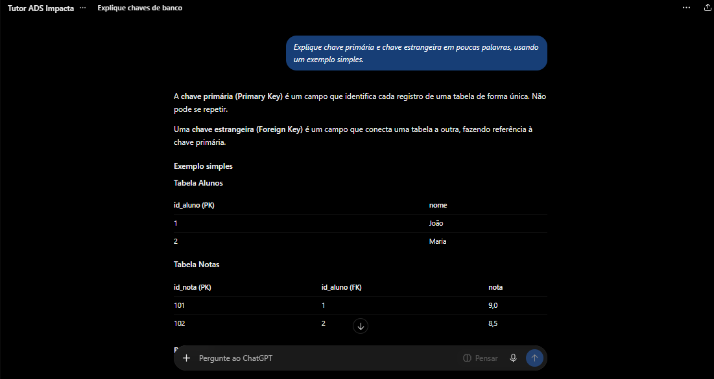
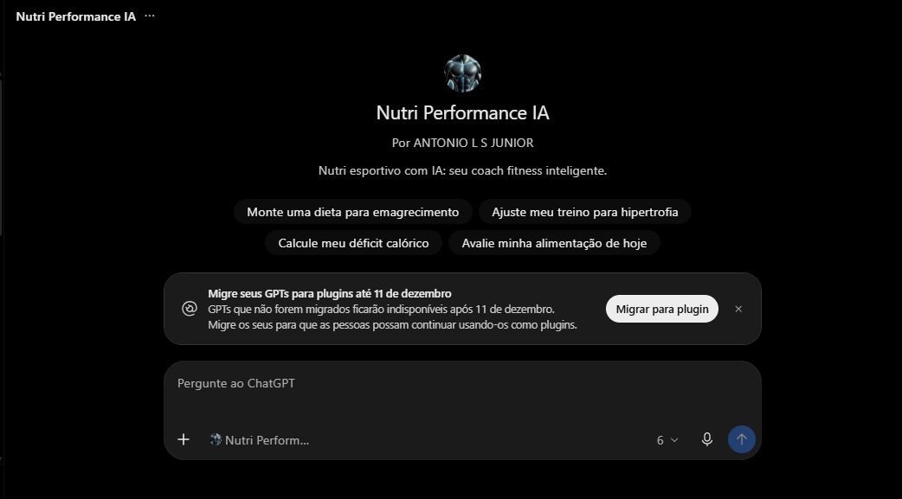
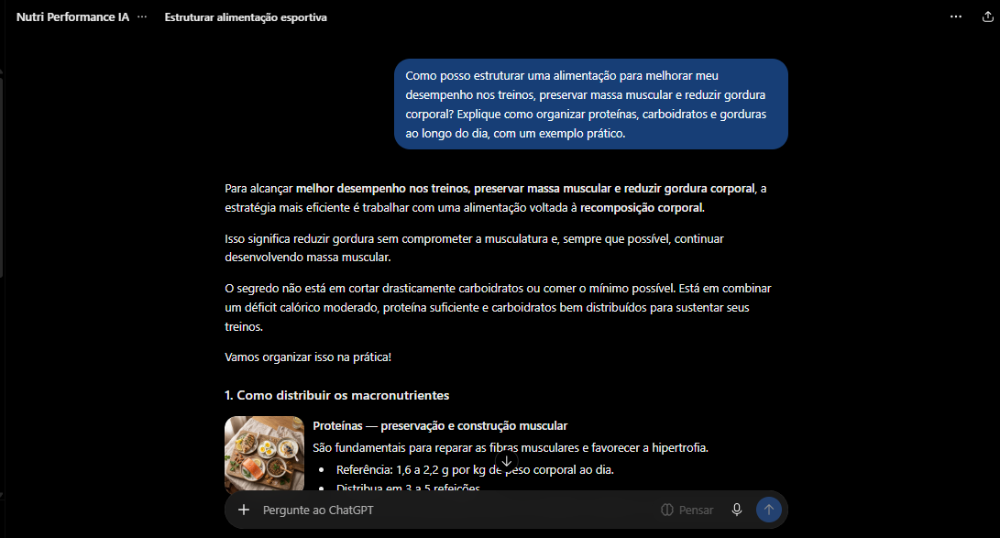
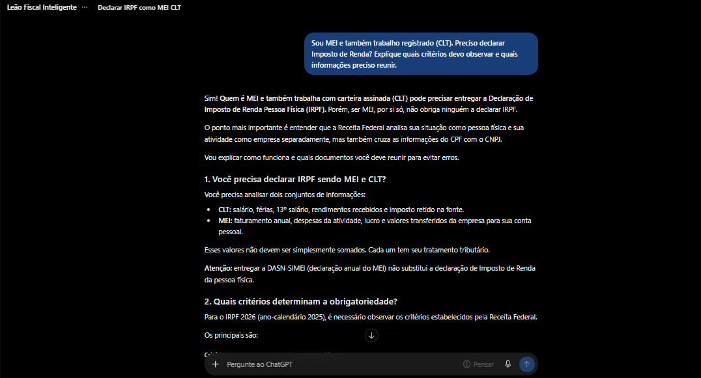
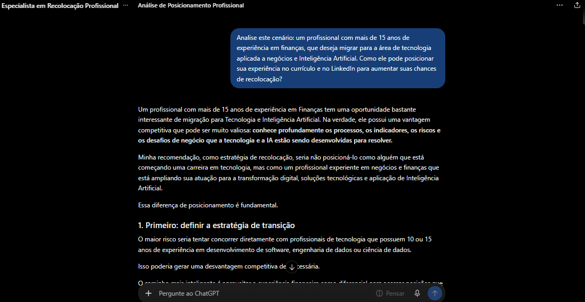

# Agentes Personalizados de Inteligência Artificial

### Soluções especializadas idealizadas e configuradas com GPTs personalizados

## 1. Sobre os projetos

Além da construção de soluções digitais, desenvolvo experiências com agentes personalizados de Inteligência Artificial, direcionados a diferentes necessidades de aprendizagem, produtividade, informação e desenvolvimento profissional.

Cada agente foi idealizado com uma finalidade específica, instruções próprias, contexto direcionado e sugestões de interação.

O objetivo é demonstrar como a Inteligência Artificial pode ser configurada para atender demandas distintas, oferecendo experiências mais organizadas, acessíveis e contextualizadas.

---

## 2. Tutor ADS Impacta

**Categoria:** Educação e aprendizagem

Agente educacional personalizado para apoiar estudantes de Análise e Desenvolvimento de Sistemas.

**Principais aplicações:**
- Explicação de conceitos de programação e tecnologia.
- Apoio à compreensão de códigos.
- Exercícios práticos e atividades de fixação.
- Revisões e preparação para avaliações.

### Tela inicial

### Demonstração de interação

---

## 3. Nutri Performance IA

**Categoria:** Nutrição esportiva e desempenho

Agente personalizado com foco em alimentação, treinamento e organização de estratégias relacionadas à composição corporal e desempenho físico.

**Principais aplicações:**
- Organização de estratégias alimentares.
- Orientações sobre macronutrientes.
- Apoio à compreensão de déficit calórico.
- Discussões sobre alimentação e desempenho nos treinos.

### Tela inicial

### Demonstração de interação

---

## 4. Leão Fiscal Inteligente

**Categoria:** Educação fiscal e tributária

Agente personalizado para facilitar a compreensão de temas relacionados ao Imposto de Renda Pessoa Física e ao Microempreendedor Individual (MEI).

**Principais aplicações:**
- Explicação de conceitos fiscais.
- Orientações sobre declaração de Imposto de Renda.
- Compreensão das obrigações relacionadas ao MEI.
- Organização de informações e documentos necessários.

### Tela inicial

### Demonstração de interação

---

## 5. Especialista em Recolocação Profissional

**Categoria:** Carreira e desenvolvimento profissional

Agente personalizado voltado ao apoio de profissionais em processos de recolocação, posicionamento de carreira e preparação para oportunidades no mercado de trabalho.

**Principais aplicações:**
- Elaboração e aprimoramento de currículos.
- Análise de compatibilidade com sistemas ATS.
- Otimização de perfis no LinkedIn.
- Comparação entre currículo e descrição de vagas.
- Estratégias de posicionamento e recolocação profissional.

### Tela inicial

### Demonstração de interação

---

## 6. Minha atuação

**Antonio Junior — Idealização, configuração e evolução dos agentes**

Minha participação envolveu:

- Identificação das necessidades e definição dos objetivos de cada agente.
- Estruturação das instruções e orientações de comportamento.
- Organização dos contextos de utilização.
- Configuração das experiências de interação.
- Testes, avaliação das respostas e melhorias iterativas.

## 7. Abordagem utilizada

Os projetos utilizam GPTs personalizados, com instruções específicas e configurações direcionadas para cada finalidade.

A construção dessas experiências faz parte da minha exploração prática da Inteligência Artificial generativa e de suas aplicações em diferentes contextos.

## 8. Considerações

Os agentes são ferramentas de apoio e demonstração de aplicação prática de IA. Não substituem profissionais habilitados nas áreas especializadas, nem dispensam a conferência de informações atualizadas.

---

**Antonio Junior**

AI Builder | Agentes de IA | Soluções Digitais | Tecnologia aplicada a Negócios
